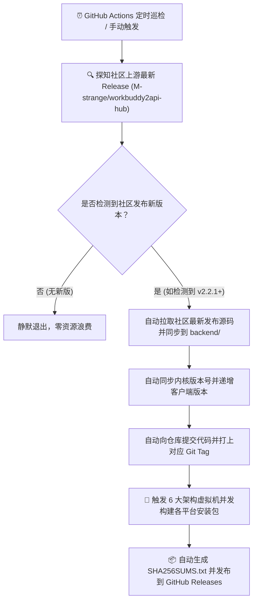

# GoingHub 🚀

> **Multi-Protocol AI Gateway Desktop Client (macOS, Windows & Linux)**  
> 原生多协议跨平台桌面客户端，基于活跃社区接管分支 [M-strange/workbuddy2api-hub](https://github.com/M-strange/workbuddy2api-hub) 持续跟进构建：免去手动终端命令与 Docker 部署，开箱即用，托盘常驻，为所有 AI 客户端提供即开即用的标准多协议接口（兼容 OpenAI Chat Completions、OpenAI Responses、Anthropic Claude Messages 及图像/视频多模态接口）。

<p align="center">
  
</p>

<p align="center">
  
  
  
  
  
</p>

---

> ### ⚠️ 免责声明 (Disclaimer)
> 本项目仅用于协议学习与个人开发测试，不提供任何商业服务或可用性担保。因使用非官方客户端产生的账号风控、限制或封禁由使用者自行承担，请优先使用官方客户端。  
> *(This project is intended solely for protocol study and personal development/testing, without any commercial service or availability warranty. Any account risk control, restriction, or ban resulting from using unofficial clients is entirely the user's responsibility. Please prioritize using official clients.)*

---

## 🌟 核心特性 (Key Features)

GoingHub 将活跃社区接管的核心网关封装为完整的跨平台原生应用：

1. **双击即启**：像使用普通桌面软件一样双击图标即启动，内嵌独立便携 Python 3.11 环境，无需预装任何运行库；
2. **托盘常驻 & 无痕后台**：关闭窗口时自动最小化到系统托盘，macOS Dock 栏与 Windows 任务栏彻底隐藏无残留，安安静静在系统状态栏常驻；
3. **✨ 深度集成社区接管增强**：
   - **来源 IP 全链路与归属地视图**（`wb_client_geo`）；
   - **账号池并发排队等待**：名额释放立即唤醒，避免误报 502；
   - **超半数熔断自动探活**：防止死锁，保障服务高可用；
   - **上游超时优化**（45s/90s）与 listen backlog 扩容。
4. **🌐 全面支持多种大模型协议**：
   - **OpenAI Chat Completions 协议**（`/v1/chat/completions`）：兼容 NextChat、Cherry Studio、Chatbox、LobeChat、Cursor 等各类主流工具；
   - **OpenAI Responses API 协议**（`/v1/responses`）：原生适配 OpenAI Codex CLI 命令行工具；
   - **Anthropic Claude Messages 协议**（`/v1/messages`）：支持 Claude Code 命令行编程工具原生调用；
   - **多模态图像与视频生成接口**（`/v1/images/generations`、`/v1/videos`）：支持图像生成、编辑与视频任务生成；
5. **🤖 自动化社区 Release 追踪同步**：配置了 GitHub Actions 自动化流水线，定时巡检社区上游 [M-strange/workbuddy2api-hub](https://github.com/M-strange/workbuddy2api-hub)，一旦发布新版本，全自动拉取最新源码并完成全平台 6 大架构的自动构建与自动发布；
6. **🚀 原地内核热更新**：已安装的客户端开机自动检查或托盘一键热更新，2 秒内自动拉取社区源码原地热更，免去重新下载 DMG/EXE 的繁琐；
7. **跨平台全覆盖**：完美支持 **macOS（Intel + Apple Silicon）**、**Windows（x64 + ARM64）**、**Linux（x64 + ARM64）**。

---

## ⏱️ 自动化社区同步流水线 (Community Upstream Auto-Sync)



---

## 📥 快速下载与安装

前往 [Releases 页面](https://github.com/scott20201225/GoingHub/releases) 下载适合你操作系统的安装包。本软件支持 **3 大主流操作系统平台（macOS、Windows、Linux）**，针对不同芯片架构分别适配。安装包内已**内嵌便携独立 Python 3.11**，无需在电脑上预装 Python 或 Node.js，真正开箱即用：

| 操作系统平台 | 芯片架构 | 推荐下载文件 | 适用设备说明 |
| :--- | :--- | :--- | :--- |
| **Windows** | **64 位 (`x64`)** | `GoingHub-*-win-x64-setup.exe` / `.zip` | 主流 Windows 10/11 x64 PC（Intel / AMD） |
| **Windows** | **ARM64 (`arm64`)** | `GoingHub-*-win-arm64-setup.exe` / `.zip` | 高通骁龙等 Windows on ARM 设备 |
| **macOS** | **Apple Silicon (`arm64`)** | `GoingHub-*-mac-arm64.dmg` / `.zip` | M1 / M2 / M3 / M4 芯片 Mac |
| **macOS** | **Intel (`x64`)** | `GoingHub-*-mac-x64.dmg` / `.zip` | Intel 处理器 Mac |
| **Linux** | **x86_64 (`x64`)** | `GoingHub-*-linux-x86_64.AppImage` / `.deb` | 主流 x64 Linux 发行版（Ubuntu/Debian等） |
| **Linux** | **AArch64 (`arm64`)** | `GoingHub-*-linux-arm64.AppImage` / `.tar.gz` | 树莓派、ARM 架构 Linux 设备 |

### 🍎 macOS 安装与“软件已损坏”解决说明

由于 macOS 版本采用自签名（未申请付费 Apple 开发者证书），首次启动时 macOS Gatekeeper 可能会拦截并提示 **“GoingHub 已损坏，无法打开。你应该将它移到废纸篓”** 或 **“来自未知的开发者”**。

这属于 macOS 对第三方开源无证书应用的通用机制，软件完全安全。请按以下方法一键解除：

1. 打开 macOS **终端**（Terminal）；
2. 运行以下命令：
   ```bash
   sudo xattr -r -d com.apple.quarantine /Applications/GoingHub.app
   ```
3. 按回车并输入 Mac 开机密码即可（输入时不显示字符，输完直接回车）；
4. 重新点击启动 `/Applications/GoingHub.app` 即可正常使用！

> 💡 **提示**：若未将软件拖入系统的 `应用程序`（Applications）文件夹，在终端中输入 `sudo xattr -r -d com.apple.quarantine `（注意最后保留一个空格），然后直接将 `GoingHub.app` 图标拖拽进终端窗口后回车即可。

---

## ℹ️ 关于本客户端 (About GoingHub)

### 中文说明 (Chinese)
* **定位与归属**：本软件是基于社区活跃接管分支 [M-strange/workbuddy2api-hub](https://github.com/M-strange/workbuddy2api-hub) 构建的原生多协议大模型网关客户端。
* **多协议接口支持**：不仅支持标准 OpenAI Chat Completions 协议，还全面支持 OpenAI Responses（Codex CLI）、Anthropic Claude Messages（Claude Code）以及多模态图像/视频生成等多种主流 API 协议格式。
* **社区功能同步**：紧跟社区演进，首发版本已集成 `v2.2.0` 最新特性（包含来源 IP 全链路与归属地视图、账号池排队等待、超半数熔断自动探活）。
* **自动化跟进机制**：本项目配置了 GitHub Actions 自动化巡检定时任务，自动跟进社区上游版本发布，并在几分钟内全自动完成全平台 6 大架构构建与发版。
* **免责声明**：本项目仅用于协议学习与个人开发测试，不提供任何商业服务或可用性担保。因使用非官方客户端产生的账号风控、限制或封禁由使用者自行承担，请优先使用官方客户端。

### English Description
* **Project Nature**: GoingHub is a cross-platform multi-protocol AI gateway desktop client tracking the active community branch [M-strange/workbuddy2api-hub](https://github.com/M-strange/workbuddy2api-hub).
* **Multi-Protocol API Support**: Converts model requests into multiple standard AI protocols—not just OpenAI Chat Completions, but also OpenAI Responses (for Codex CLI), Anthropic Claude Messages (for Claude Code), and Multimodal Image/Video Generation APIs.
* **Community Features**: Ships with kernel `v2.2.0`, featuring origin IP geo inspection (`wb_client_geo`), concurrency queue waiting, and automatic circuit-breaker health probes.
* **Dual-Track Updates**: Features automated GitHub Actions CI/CD matrix builds and in-place 2-second atomic hot-updates via the system tray.
* **Disclaimer**: This project is intended solely for protocol study and personal development/testing, without any commercial service or availability warranty. Any account risk control, restriction, or ban resulting from using unofficial clients is entirely the user's responsibility. Please prioritize using official clients.

---

## 🛠️ 本地开发与调试

### 前置要求
- **Node.js** >= 18
- **Python** >= 3.9（网关核心基于 Python 标准库，无须额外 pip 依赖）

### 运行步骤

```bash
# 1. 克隆代码仓库
git clone https://github.com/scott20201225/GoingHub.git
cd GoingHub

# 2. 安装依赖
npm install

# 3. 启动开发模式（自动启动后台并弹出桌面应用）
npm start
```

---

> 📦 各平台的打包构建与 CI/CD 自动发布详细说明已独立归档至 [BUILD.md](docs/BUILD.md)。

---

## 📄 开源许可证

本项目基于 [MIT 许可证](LICENSE) 开源。  
社区上游核心归属：[M-strange/workbuddy2api-hub](https://github.com/M-strange/workbuddy2api-hub)。
